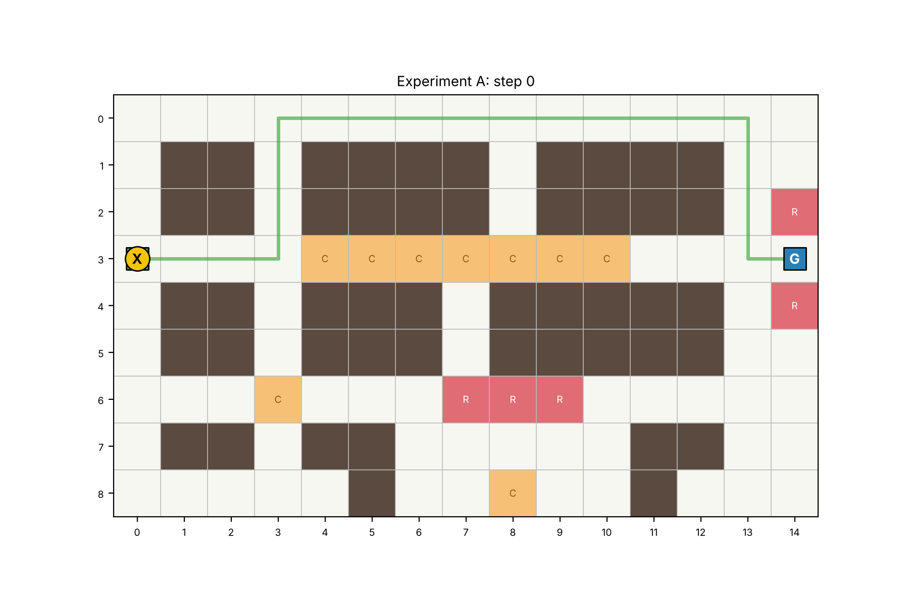
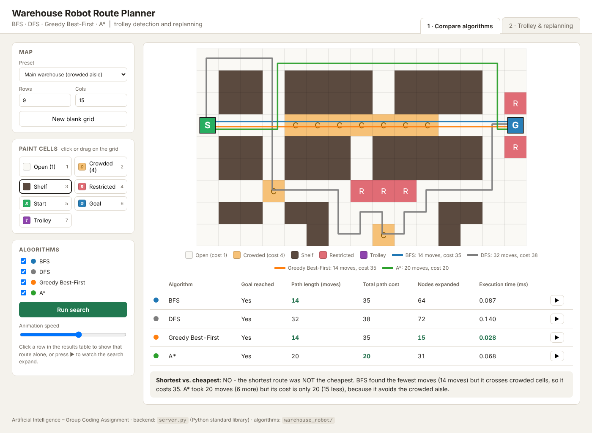
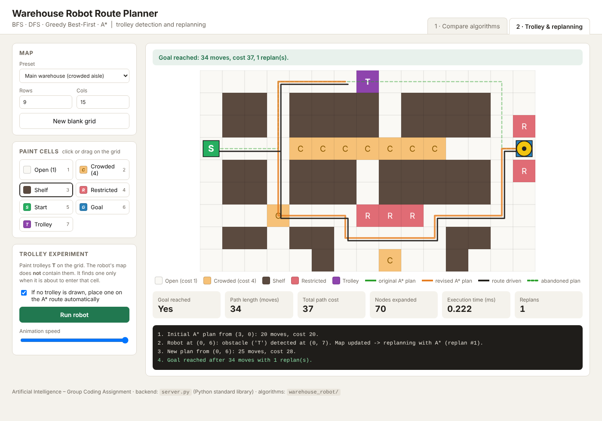
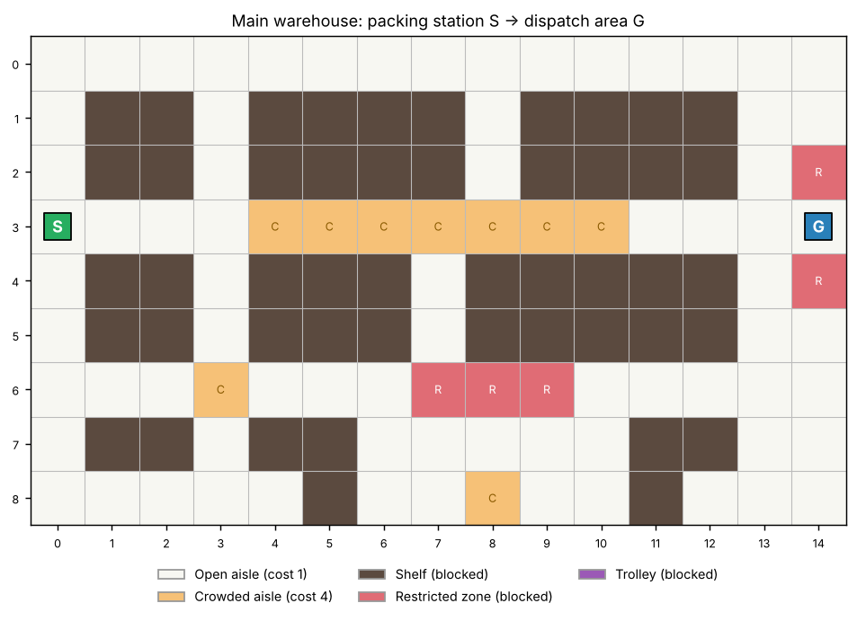
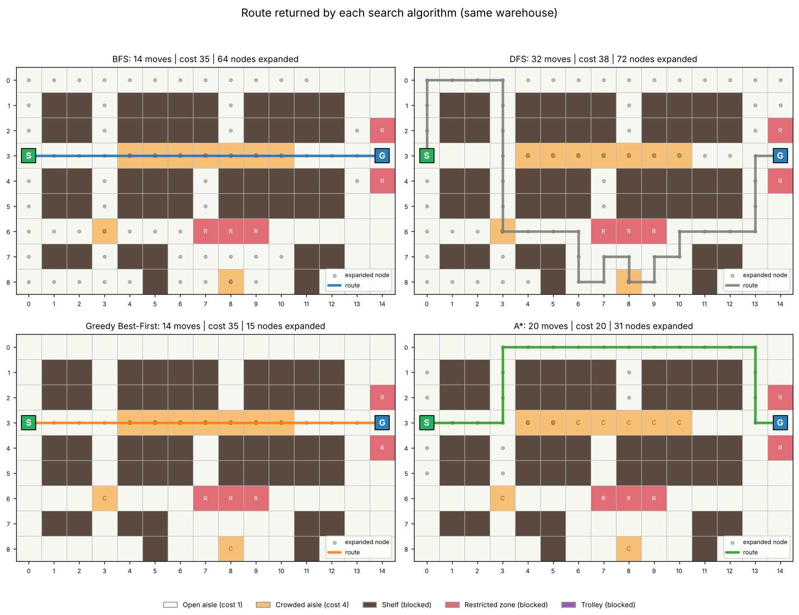
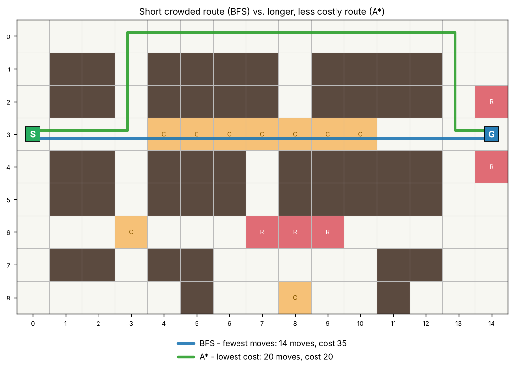
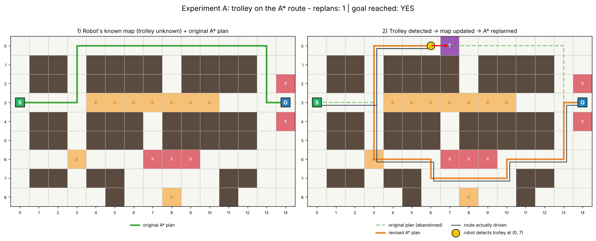
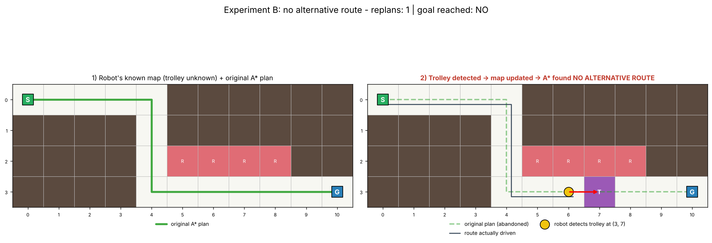
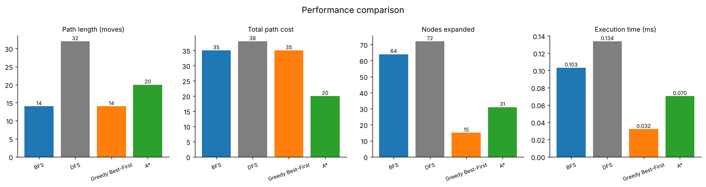

# AI-Based Route Planning for a Warehouse Delivery Robot

**Course:** Artificial Intelligence — Group Coding Assignment  
**Group:** 07 
**Language:** Python 3

A simulated warehouse robot plans a route from the **packing station (S)** to the **dispatch area (G)** on a 2D grid. We compare **BFS, DFS, Greedy Best-First Search and A\***. Then we show what the robot does when it finds a **trolley** blocking its planned route that was missing from its map: it detects the trolley, updates its map and **replans with A\***.



The project has two front ends that use the same algorithms:
* **Web UI** (`python server.py`). An interactive browser app where you edit the warehouse, compare the algorithms and watch the robot detect a trolley and replan.
* **Console + figures** (`python main.py`). Runs all five tasks, prints the results and saves the figures, GIFs and tables to `outputs/`.

---

## Contents
1. [Problem statement](#1-problem-statement)
2. [Team members and contributions](#2-team-members-and-contributions)
3. [Project structure](#3-project-structure)
4. [How to run](#4-how-to-run) (and [Troubleshooting](#troubleshooting-windows))
5. [Task 1 – Warehouse environment](#5-task-1--warehouse-environment)
6. [Task 2 – Problem formulation](#6-task-2--problem-formulation)
7. [Task 3 – Search algorithms](#7-task-3--search-algorithms)
8. [Task 4 – Trolley detection and replanning](#8-task-4--trolley-detection-and-replanning)
9. [Task 5 – Performance evaluation](#9-task-5--performance-evaluation)
10. [Findings](#10-findings)
11. [References and acknowledgements](#11-references-and-acknowledgements)

---

## 1. Problem statement

A warehouse robot carries packages from a packing station to a dispatch area. Shelves and restricted zones block some routes, and crowded aisles take longer to cross. A trolley may also block a route that the robot initially believes is clear.

Our task is to develop a simulated delivery robot that searches for a route on a 2D warehouse grid. We compare four search algorithms and show how the robot reacts when it discovers an obstacle on its planned route.


## 2. Project structure

```
AI_Warehouse_PathPlanning_GroupXX/
├── main.py                     # runs all 5 tasks, prints results, saves outputs
├── server.py                   # web UI backend (Python standard library only)
├── web/                        # web UI frontend: index.html, style.css, app.js
├── requirements.txt            # numpy, matplotlib
├── warehouse_robot/
│   ├── grid.py                 # Task 1: grid, cell types, costs, moves, ASCII rendering
│   ├── layouts.py              # warehouse maps used in the experiments
│   ├── problem.py              # Task 2: state, actions, transition, goal test, cost, heuristic
│   ├── algorithms.py           # Task 3: BFS, DFS, Greedy Best-First, A*
│   ├── replanning.py           # Task 4: trolley detection, map update, A* replanning
│   ├── evaluate.py             # Task 5: comparison tables (console / CSV / Markdown)
│   └── visualize.py            # Matplotlib figures and GIF animations
├── tests/test_warehouse.py     # 10 unit tests (unittest, no extra install)
└── outputs/                    # generated figures, GIFs, CSV tables, console log
```

## 3. How to run

### Requirements
* Python **3.10 or newer** (tested with 3.13)
* `numpy` and `matplotlib` (Pillow, used to save the GIFs, is installed with matplotlib)

### Steps

```bash
# 1. Get the code
git clone https://github.com/<username>/AI_Warehouse_PathPlanning_GroupXX.git
cd AI_Warehouse_PathPlanning_GroupXX

# 2. (Optional) create a virtual environment
python -m venv venv
venv\Scripts\activate          # Windows
source venv/bin/activate       # macOS / Linux

# 3. Install the dependencies
pip install -r requirements.txt

# 4. Run the full program
python main.py
```

On macOS or Linux, use `python3` if `python` is not found.

### Web UI (recommended for the demo)

```bash
python server.py
```

Your browser opens **http://127.0.0.1:8000**. If it does not open, paste that address into the browser yourself. Press `Ctrl+C` in the terminal to stop the server. The web UI needs **no extra packages**: the backend uses only Python's standard library, and the frontend is plain HTML/CSS/JavaScript with no internet connection required. Options: `--port 9000` and `--no-browser`.

* **Tab 1 – Compare algorithms.** Pick a preset or paint your own warehouse (click or drag; keys 1–7 choose the cell type), then press *Run search*. The routes of all four algorithms are drawn on the grid, the comparison table highlights the best value in each column, and the shortest-vs-cheapest verdict appears under it. Click a row to see that route and its expanded nodes, or press ▶ to watch the search expand node by node.
* **Tab 2 – Trolley & replanning.** Paint trolleys (`T`) or let the app place one on the A\* route. The trolley is drawn faded because the robot does not know about it. Press *Run robot* to watch the robot follow its plan, detect the trolley one cell ahead, update its map and replan with A\* (or report that no alternative exists). Metrics and a step log are shown under the grid.

| API endpoint | Purpose |
|---|---|
| `GET /api/layouts` | Preset warehouse maps |
| `POST /api/search` `{"layout": [...], "algorithms": [...]}` | Route and metrics for each algorithm |
| `POST /api/replan` `{"layout": [...], "auto_trolley": true}` | Trolley detection and replanning result |




### Console program and figures

`python main.py` prints every task to the console and saves all figures, GIFs and tables in `outputs/`. Creating the GIFs takes about 20–30 seconds.

| Command | What it does |
|---|---|
| `python main.py` | Runs all 5 tasks and saves everything to `outputs/` |
| `python main.py --show` | Also opens every figure and animation in a window |
| `python main.py --no-animation` | Skips the GIFs (finishes in a few seconds) |
| `python main.py --trolley 0 9` | Puts the trolley at row 0, column 9 (the cell must lie on the A\* route) |
| `python -m unittest discover -s tests -v` | Runs the unit tests |

### Troubleshooting (Windows)

**`ImportError: DLL load failed ... An Application Control policy has blocked this file`**

Windows *Smart App Control* blocks a compiled matplotlib file. This happens most often on a very new Python version (for example 3.15), whose library builds Windows does not trust yet. The program still runs all tasks and prints all tables, but it skips the figures. **The web UI (`python server.py`) is not affected**, because it does not use matplotlib. To get the figures as well:
1. Install **Python 3.12 or 3.13** from python.org and create a virtual environment with it: `py -3.13 -m venv venv`, then `venv\Scripts\activate`, then `pip install -r requirements.txt`, then `python main.py`.
2. If the error remains, the PC's Smart App Control or an organisation policy is blocking the file. You can run the project on another PC or on Google Colab instead (upload the folder, then `!python main.py`).

## 4. Task 1 – Warehouse environment

| Symbol | Cell | Cost to enter |
|---|---|---|
| `.` | open aisle | 1 |
| `C` | crowded aisle | 4 |
| `#` | shelf | blocked |
| `R` | restricted zone | blocked |
| `T` | trolley (true map only) | blocked |
| `S` / `G` | start (packing station) / goal (dispatch area) | 1 |

The robot can move **Up, Down, Left and Right**. The main warehouse is 9 × 15:

```
     0 1 2 3 4 5 6 7 8 9 0 1 2 3 4
  0 |. . . . . . . . . . . . . . . |
  1 |. # # . # # # # . # # # # . . |
  2 |. # # . # # # # . # # # # . R |
  3 |S . . . C C C C C C C . . . G |
  4 |. # # . # # # . # # # # # . R |
  5 |. # # . # # # . # # # # # . . |
  6 |. . . C . . . R R R . . . . . |
  7 |. # # . # # . . . . . # # . . |
  8 |. . . . . # . . C . . # . . . |
```

The straight aisle from S to G is **crowded**. It is the shortest route in moves but expensive. The open aisle along the top is longer but cheaper. This is our *short crowded route vs. longer, less costly route* test.



## 6. Task 2 – Problem formulation

| Component | Definition |
|---|---|
| **State** | Robot position `(row, col)` |
| **Initial state** | Packing station S = `(3, 0)`. When replanning, it is the robot's current cell. |
| **Actions(s)** | The moves among {Up, Down, Left, Right} whose target cell is inside the grid and is not a shelf, a restricted zone or a known trolley |
| **Transition model** | `Result(s, a) = s + Δ(a)`, where Up = (−1, 0), Down = (+1, 0), Left = (0, −1), Right = (0, +1) |
| **Goal test** | `s == G = (3, 14)` |
| **Path cost** | Sum of step costs. `c(s, a, s')` is the cost of **entering** `s'`: 1 for an open cell, 4 for a crowded cell. |
| **Heuristic** | `h(s) = |r − r_G| + |c − c_G|` (Manhattan distance), used by Greedy and A\* |

## 7. Task 3 – Search algorithms

All four algorithms use graph search (no state is expanded twice). They share the same successor order (Up, Down, Left, Right) and apply the goal test when a node is removed from the frontier, so their results can be compared fairly.

| Algorithm | Frontier | Ordered by | Optimal? |
|---|---|---|---|
| **BFS** | FIFO queue | depth | Fewest **moves**, but ignores cell costs |
| **DFS** | LIFO stack | most recent node | No |
| **Greedy Best-First** | priority queue | `h(n)` | No |
| **A\*** | priority queue | `f(n) = g(n) + h(n)` | Yes, lowest **cost**, because `h` is admissible and consistent |

### Why Manhattan distance is a lower bound on the remaining travel cost
1. Each move changes either the row or the column by exactly 1. To reach G the robot therefore needs **at least** `|Δrow| + |Δcol|` moves. Obstacles can only make the route longer.
2. Every move costs **at least 1** (open = 1, crowded = 4).
3. So *remaining cost ≥ number of remaining moves ≥ Manhattan distance*. `h` never overestimates, which makes it **admissible**.

It is also **consistent**: one move changes `h` by at most 1 and costs at least 1, so `h(n) ≤ c(n, n') + h(n')`. With a consistent heuristic, A\* never has to re-open a closed node and always returns the lowest-cost route. The unit tests check admissibility against the true optimal cost (computed with uniform-cost search) from every free cell.

### Results: route found by each algorithm


### Short crowded route vs. longer, less costly route


* **BFS** (and Greedy) go straight through the crowded aisle: **14 moves, cost 35**. 7 crowded cells × 4 + 7 open cells × 1 = 35.
* **A\*** takes the open top aisle: **20 moves, cost 20**. That is 6 more moves but **15 less cost**.

## 8. Task 4 – Trolley detection and replanning

The program keeps two maps:
* the **true map**, which contains the trolley, and
* the robot's **known map**, which does not contain the trolley.

Algorithm (`replanning.py`):
1. Plan a route with A\* on the known map.
2. Before each move, the sensor checks the **next cell** on the true map.
3. If that cell is blocked, the robot stops **before entering it**, marks it as `T` on its known map, increases the replan counter, and runs **A\* again from its current position**.
4. If A\* finds no route, the robot reports *"no alternative route"* and stops safely.

**Experiment A – trolley on the initial A\* route.** The trolley is placed halfway along the route, at `(0, 7)`. The robot detects it from `(0, 6)`, replans, and reaches G through the lower aisles.



**Experiment B – no alternative.** A single-corridor warehouse has a trolley at `(3, 7)`. The robot detects it, replans, and correctly reports that no route exists.



Animations: [`outputs/06_replanning_animation.gif`](outputs/06_replanning_animation.gif) and [`outputs/07_replanning_failure_animation.gif`](outputs/07_replanning_failure_animation.gif).

Console excerpt:
```
> Initial A* plan from (3, 0): 20 moves, cost 20.
> Robot at (0, 6): obstacle ('T') detected at (0, 7). Map updated -> replanning with A* (replan #1).
> New plan from (0, 6): 25 moves, cost 28.
> Goal reached after 34 moves with 1 replan(s).
```

## 9. Task 5 – Performance evaluation

**Algorithm comparison (main warehouse).** Execution time is the average of 30 runs. Times depend on the machine, so your numbers may differ slightly.

| Algorithm | Goal reached | Path length (moves) | Total path cost | Nodes expanded | Execution time (ms) |
|---|---|---|---|---|---|
| BFS | Yes | 14 | 35 | 64 | 0.108 |
| DFS | Yes | 32 | 38 | 72 | 0.157 |
| Greedy Best-First | Yes | 14 | 35 | 15 | 0.035 |
| A\* | Yes | **20** | **20** | 31 | 0.072 |

**Trolley experiments (A\* with replanning).** Nodes expanded are summed over all plans.

| Scenario | Goal reached | Path length (moves) | Total path cost | Nodes expanded | Execution time (ms) | Replans |
|---|---|---|---|---|---|---|
| A: trolley on A\* route | Yes | 34 | 37 | 70 | 0.319 | 1 |
| B: dead-end corridor | No | 9 | 9 | 24 | 0.096 | 1 |

In scenario A, the moves and cost include the 9 moves driven before the trolley was found, after which the robot had to turn back.



Every run also writes `outputs/algorithm_comparison.csv`, `outputs/replanning_results.csv`, `outputs/results.md` and the full console log `outputs/console_output.txt`.

## 10. Findings

* **The shortest route was not the cheapest.** BFS found the fewest moves (14), but that route crosses 7 crowded cells and costs 35. A\* took 6 more moves (20) and cost only 20. BFS minimises the number of moves; A\* minimises the actual travel cost.
* **A\* is the right planner for this robot.** It gives the lowest-cost route and expands only 31 nodes, about half as many as BFS (64).
* **Greedy Best-First is the fastest but short-sighted.** It expanded only 15 nodes, but it follows `h` straight into the crowded aisle and is not optimal.
* **DFS** found a route, but it is the longest (32 moves) and the most expensive (38).
* **Replanning works.** The robot detected the unknown trolley one cell ahead, updated its map and reached G with 1 replan. In the dead-end warehouse it correctly reported that no alternative route exists.

## 11. References and acknowledgements

* S. Russell and P. Norvig, *Artificial Intelligence: A Modern Approach*, 4th ed., Ch. 3 (Solving Problems by Searching).
* P. E. Hart, N. J. Nilsson and B. Raphael, "A Formal Basis for the Heuristic Determination of Minimum Cost Paths," *IEEE Trans. SSC*, 1968.
* Python standard library (`heapq`, `collections.deque`), [NumPy](https://numpy.org/), [Matplotlib](https://matplotlib.org/).
* Code structure and documentation were drafted with help from an AI assistant (Claude) and reviewed, tested and explained by the group members.
